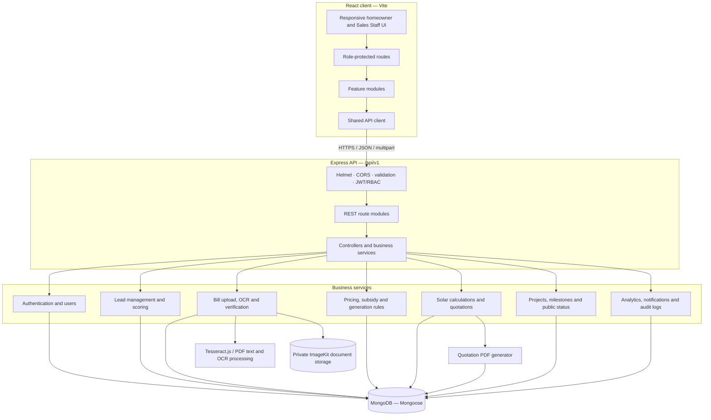
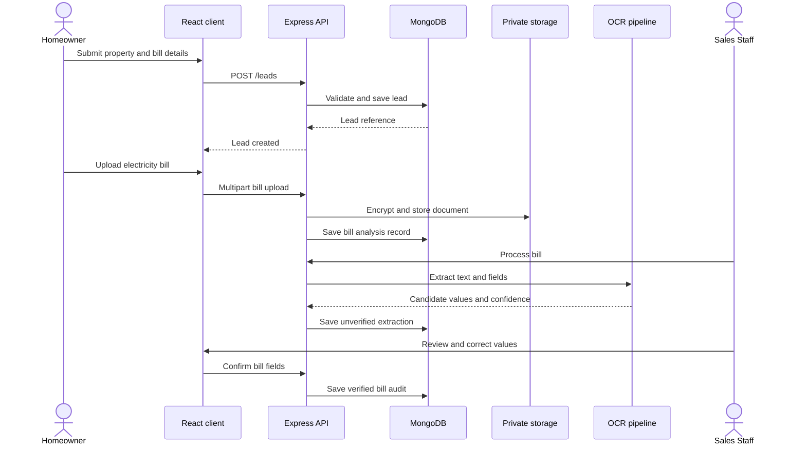

<div align="center">

# SolarQualify

### Rooftop solar lead qualification, intelligent bill analysis, quotations and project tracking

A full-stack platform that helps solar installers turn homeowner enquiries into qualified opportunities, generate transparent solar proposals, and keep customers informed throughout an installation.

[](https://github.com/digvijay1129/solarqualify/actions)
[](https://github.com/digvijay1129/solarqualify/actions)

</div>

---

## Overview

SolarQualify digitizes the core workflow of a rooftop solar installation business. Homeowners submit property details and electricity bills through a responsive portal. Sales staff review extracted bill information, qualify leads using explainable rules, prepare quotations using effective-dated business rules, and manage projects through a customer-shareable status page.

The application is built as a JavaScript monorepo with a React frontend, an Express API and MongoDB persistence.

## Product capabilities

| Area | Capabilities |
|---|---|
| Authentication and access | Homeowner and Sales Staff accounts, JWT authentication, protected routes and resource-level authorization |
| Homeowner enquiries | Lead submission, property ownership, roof type and area, PIN code, monthly bill and consumption details |
| Electricity bill analysis | PDF and image upload, OCR extraction of consumer number, tariff, sanctioned load and units, followed by human review and correction |
| Lead qualification | Explainable weighted score, priority classification, data-gap guidance and consumption-based solar sizing |
| Business rules | Versioned pricing, subsidy and generation rules with effective dates and approval/verification states |
| Solar quotations | Deterministic system sizing, generation, cost, subsidy, savings and payback calculations; saved calculation snapshots and downloadable quotation PDFs |
| Customer decisions | Homeowner quotation acceptance or rejection |
| Project tracking | Project creation from an accepted quotation, ordered milestones, lifecycle history and customer status links |
| Notifications and audit | Persisted in-app notification records, simulated external delivery and auditable operational events |
| Dashboard analytics | Role-scoped lead, quotation and project metrics backed by MongoDB queries |

## User roles

### Homeowner

- Register and sign in.
- Submit a rooftop solar enquiry with property and electricity details.
- Upload and review an electricity bill.
- View generated quotations and download quotation PDFs.
- Accept or decline a quotation.
- View project progress and use a secure customer status link.

### Sales Staff

- View leads assigned to their account.
- Review OCR-extracted bill values and correct them when necessary.
- Qualify leads and inspect the score explanation and missing information.
- Manage effective-dated pricing, subsidy and generation rules.
- Generate and download formal quotations.
- Convert accepted quotations into projects.
- Update project milestones and operational status.
- Issue or revoke customer status links.
- View live, account-scoped dashboard analytics.

Public registration creates homeowner accounts. Sales Staff accounts are provisioned through a controlled process.

## Architecture

SolarQualify uses a **modular monolithic architecture** inside an npm-workspaces monorepo. The frontend and backend are separate applications; business capabilities are grouped into cohesive feature modules in each application.



### Request and data flow

1. The user signs in; the API validates credentials and issues an authenticated session token.
2. The frontend uses a shared API client to call protected REST endpoints.
3. Express middleware applies security headers, CORS policy, authentication and role authorization before route handlers run.
4. Feature controllers delegate business rules to services. Mongoose models persist records and enforce schema-level constraints and indexes.
5. Bill documents are validated, encrypted and stored privately. OCR extracts candidate text and values; Sales Staff verification is the trusted step before bill data is used as verified input.
6. Quotation services select applicable effective-dated rules, calculate results deterministically and save immutable rule/input snapshots.
7. Project services enforce ordered milestone transitions, write history/audit events and create in-app notification records.

### Key design decisions

- **Modular monolith:** one deployable API with clear business boundaries, avoiding distributed-system overhead for the current product scope.
- **Human-in-the-loop OCR:** extracted values are candidates, not trusted facts. Staff must review and verify bill information.
- **Deterministic financial calculations:** AI is not used to calculate system generation, subsidy, price or payback.
- **Effective-dated rules:** pricing, subsidy and generation assumptions are selected by the quotation's effective date.
- **Immutable quotation snapshots:** later rule changes do not rewrite previously generated quotations.
- **Server-side authorization:** data access is scoped to the authenticated homeowner or assigned Sales Staff account.
- **Private document handling:** customer bills are encrypted before private object storage; document routes require authorization.
- **Honest analytics:** metrics are sourced from available backend data; unsupported historical growth or revenue metrics are not fabricated.

## Technology stack

| Layer | Technologies |
|---|---|
| Frontend | React 19, JavaScript ES Modules, Vite, React Router, Tailwind CSS |
| Data fetching and state | TanStack Query, React Context |
| Forms and validation | React Hook Form, Zod |
| Charts and UI | Recharts, Lucide React |
| Backend | Node.js 22+, Express 5 |
| Database | MongoDB, Mongoose |
| Authentication | JSON Web Tokens, bcryptjs |
| OCR and document processing | Tesseract.js, PDF.js, file-type validation |
| Document storage | ImageKit private storage, AES-256-GCM encryption |
| PDF generation | Server-side quotation PDF generation |
| Testing | Vitest, Supertest |
| Development | npm workspaces, Nodemon, GitHub Actions |

All application code is JavaScript (ES Modules); TypeScript is not used.

## Repository structure

The tree below highlights the application source and the main project documentation.

```text
solarqualify/
├── client/                         # React + Vite frontend
│   └── src/
│       ├── app/                    # App composition, router, layouts, providers
│       ├── assets/                 # Static assets
│       ├── components/             # Shared UI, layout and common components
│       ├── constants/              # Frontend constants
│       ├── features/
│       │   ├── authentication/     # Login, registration, session and roles
│       │   ├── bill-analysis/      # Bill review and verification screens
│       │   ├── dashboard/          # Sales dashboard and analytics
│       │   ├── homeowner/          # Homeowner portal and enquiries
│       │   ├── leads/              # Lead queue, details and qualification
│       │   ├── pricing/            # Pricing and business-rule administration
│       │   ├── projects/           # Project tracker and public status page
│       │   └── quotations/         # Quotation builder and history
│       ├── hooks/                  # Shared React hooks
│       ├── mocks/                  # Synthetic fixtures for tests/reference
│       ├── services/
│       │   └── api/                # Shared API client and request handling
│       ├── styles/                 # Global styles and design tokens
│       ├── test/                   # Frontend test setup
│       └── utils/                  # Shared frontend utilities
│
├── server/                         # Express + MongoDB backend
│   └── src/
│       ├── app.js                  # Express application and middleware
│       ├── server.js               # Server startup and database connection
│       ├── config/                 # Environment and database configuration
│       ├── infrastructure/
│       │   ├── notifications/      # Notification delivery adapters
│       │   ├── ocr/                # OCR infrastructure
│       │   ├── pdf/                # PDF generation utilities
│       │   └── storage/            # Private document storage adapters
│       ├── middleware/             # Authentication, authorization, errors
│       ├── modules/
│       │   ├── analytics/          # Dashboard analytics APIs
│       │   ├── audit-logs/         # Audit event records
│       │   ├── auth/               # Registration, login and sessions
│       │   ├── bill-analysis/      # OCR, parsing and bill verification
│       │   ├── bills/              # Bill models, upload, access and crypto
│       │   ├── generation/         # Generation rule model and services
│       │   ├── lead-scoring/       # Explainable lead qualification
│       │   ├── leads/              # Lead model and workflows
│       │   ├── notifications/      # In-app notification records
│       │   ├── pricing/            # Pricing rule model
│       │   ├── pricing-rules/      # Business-rule management APIs
│       │   ├── projects/           # Project lifecycle and status links
│       │   ├── quotations/         # Quotations and customer decisions
│       │   ├── solar-calculations/ # Deterministic solar calculations
│       │   ├── subsidies/          # Subsidy rule model and verification
│       │   └── users/              # User model and role data
│       ├── routes/                 # API route composition and health route
│       ├── scripts/                # Development-only scripts and demo seeder
│       └── shared/                 # Shared constants, errors and utilities
│
├── docs/                           # Architecture, API, data and phase notes
├── .github/workflows/              # Backend and frontend CI workflows
├── package.json                    # npm workspace scripts and dependencies
├── package-lock.json
├── deployment.md                   # Local setup and deployment guide
└── README.md
```

## Core workflows

### 1. Homeowner enquiry and bill analysis



Supported bill inputs include PDF, JPEG, PNG and WebP. OCR can fail or omit fields; missing or uncertain values must be corrected or confirmed by a person. Only a completed, manually verified bill is treated as verified input for downstream calculations and scoring.

### 2. Lead qualification

Lead scoring is a deterministic, explainable weighted model. It considers contact completeness, ownership, property type, monthly bill, electricity consumption and verified bill information. The API stores the score, priority, scoring model version, reasons and data gaps.

A low score is a follow-up signal, not a rejection decision. Staff can use a short call to clarify missing information before scheduling a survey.

### 3. Solar sizing and quotation

The quotation engine selects active pricing, subsidy and generation rule versions for the requested effective date. It then calculates system capacity, expected annual generation, equipment and installation cost, applicable verified subsidy, net cost, estimated annual savings and payback. The result is saved with rule snapshots and calculation inputs and can be rendered as a PDF.

Core formulas:

| Measure | Calculation |
|---|---|
| Annual consumption | Monthly units × 12 |
| Required capacity | Annual consumption ÷ configured annual generation per kW |
| Recommended capacity | Required capacity rounded up to 0.5 kW increments, subject to comparable verified sanctioned-load cap |
| Annual generation | System capacity × configured units per kW per year |
| Gross installation cost | Equipment cost + installation charges |
| Net installation cost | Gross cost − applicable verified subsidy |
| Estimated annual savings | Covered annual units × implied average bill tariff |
| Estimated payback | Net installation cost ÷ estimated annual savings |

The initial generation assumption from the client brief is 1,400 units per kW per year and is configurable through dated rule records. Roof type, area and PIN code are retained for assessment and audit; the application does not invent an engineering roof-area-to-kW conversion. Final design remains subject to site survey and technical validation.

**Subsidy safety:** the client-provided subsidy schedule is stored as an unverified demonstration rule. The engine applies only an active, effective-dated rule marked verified. The demo subsidy is therefore not treated as an official entitlement or included in customer offers by default. Verify current scheme rules and customer eligibility before production use.

### 4. Quotation decision and project tracking

A homeowner can accept or reject a generated quotation. Sales Staff can create a project from an accepted quotation. The project starts at the first milestone and progresses through ordered stages. Stage changes are validated by the backend and recorded in project history, audit events and simulated in-app notifications.

Sales Staff or an authorized homeowner can issue or revoke a time-limited customer status link. The public status view exposes limited project progress only; its random token is stored as a hash and is not logged in plaintext.

## API surface

Base path: `/api/v1`

| Resource | Representative endpoints | Purpose |
|---|---|---|
| Health | `GET /health` | API health |
| Authentication | `POST /auth/register`, `POST /auth/login`, `GET /auth/me`, `POST /auth/logout` | User sessions |
| Leads | `/leads`, `/leads/:leadId/qualify`, `/leads/:leadId/qualification` | Enquiries and qualification |
| Bills | `/leads/:leadId/bills`, `/bill-analyses/:analysisId/process`, `/bill-analyses/:analysisId/verification` | Upload, extraction and review |
| Business rules | `/rules/pricing`, `/rules/subsidies`, `/rules/generation` | Effective-dated rule management |
| Calculations | `/leads/:leadId/solar-calculations` | Deterministic solar estimates |
| Quotations | `/leads/:leadId/quotations`, `/quotations/:quotationId/pdf`, `/quotations/:quotationId/decision` | Quotation history, PDF and customer decision |
| Projects | `/quotations/:quotationId/project`, `/projects`, `/projects/:projectId/status` | Project creation and lifecycle |
| Customer status | `/projects/:projectId/public-status-token`, `/public/project-status/:token` | Issue, revoke and view public progress |
| Analytics | `/analytics/dashboard` | Role-scoped dashboard data |
| Audit | `/audit-logs` | Authorized operational audit history |

Authenticated endpoints require a valid session and enforce record ownership or staff assignment. Public routes are limited to registration, login, health and token-based project status.

## Local development

### Prerequisites

- Node.js 22 or newer
- npm 10 or newer
- MongoDB 7 or MongoDB Atlas
- Git

### 1. Clone and install

```bash
git clone https://github.com/digvijay1129/solarqualify.git
cd solarqualify
npm install
```

### 2. Configure environment variables

Create backend and frontend environment files from the templates:

**Windows PowerShell**
```powershell
Copy-Item server/.env.example server/.env
Copy-Item client/.env.example client/.env
```

**macOS / Linux**
```bash
cp server/.env.example server/.env
cp client/.env.example client/.env
```

Configure the backend values in `server/.env`:

| Variable | Description |
|---|---|
| `NODE_ENV` | `development`, `test` or `production` |
| `PORT` | API port; defaults to `5000` |
| `MONGODB_URI` | MongoDB connection string |
| `JWT_SECRET` | Random secret of at least 32 characters |
| `JWT_EXPIRES_IN` | Session lifetime; defaults to `1h` |
| `CLIENT_ORIGIN` | Exact frontend origin allowed by CORS |
| `MAX_UPLOAD_MB` | Upload size limit; defaults to `5`, maximum `20` |
| `IMAGEKIT_PUBLIC_KEY` | ImageKit public key |
| `IMAGEKIT_PRIVATE_KEY` | ImageKit private key |
| `IMAGEKIT_URL_ENDPOINT` | ImageKit URL endpoint |
| `DOCUMENT_ENCRYPTION_KEY` | Base64-encoded 32-byte AES key |

Configure the frontend in `client/.env`:

```env
VITE_API_BASE_URL=http://127.0.0.1:5000/api/v1
VITE_DEFAULT_LOCALE=en
```

Generate unique secrets locally; never commit `.env` files or put server secrets in `VITE_*` variables.

macOS / Linux:
```bash
openssl rand -base64 32
```

PowerShell:
```powershell
$bytes = New-Object byte[] 32
[System.Security.Cryptography.RandomNumberGenerator]::Fill($bytes)
[Convert]::ToBase64String($bytes)
```

Use a separate random value for `JWT_SECRET` and `DOCUMENT_ENCRYPTION_KEY`. The encryption key must decode to exactly 32 bytes. Keep a secure backup because losing the key makes encrypted customer documents unreadable. Set the required document-storage credentials for the configured ImageKit storage adapter.

### 3. Start MongoDB and the applications

Start MongoDB, then use two terminals from the repository root.

**Terminal 1 — backend**
```bash
npm run dev:server
```

**Terminal 2 — frontend**
```bash
npm run dev:client
```

Open:

- Frontend: [http://127.0.0.1:5173](http://127.0.0.1:5173)
- API health: [http://127.0.0.1:5000/api/v1/health](http://127.0.0.1:5000/api/v1/health)

### 4. Load synthetic demo data

With the backend environment and MongoDB configured:

```bash
npm run seed:demo
```

The development-only script creates synthetic Homeowner and Sales Staff accounts, the three sample leads, and labelled illustrative pricing, generation and unverified subsidy rules. It refuses to run when `NODE_ENV=production` and can be re-run to update the same demo records.

Local-only demo credentials:

| Role | Email | Password |
|---|---|---|
| Sales Staff | `sales.demo@solarqualify.local` | `SolarQualifyDemo!2026` |
| Homeowner | `homeowner.demo@solarqualify.local` | `SolarHomeownerDemo!2026` |

These credentials are strictly for a local development database. Never use them in a deployed environment. The demo seed does not create a bill image; upload a synthetic test bill to exercise document processing and OCR. Demo equipment pricing is illustrative, and the subsidy remains unverified.

### 5. Run tests and build

From the repository root:

```bash
npm run test:client
npm run build:client
npm run test:server
```

## Deployment topology

The documented deployment topology is:

| Component | Target |
|---|---|
| Frontend | Vercel — build the `client` workspace |
| API | Render — Node web service running `npm run start:server` |
| Database | MongoDB Atlas |
| Private documents | ImageKit private storage |

Set `VITE_API_BASE_URL` to the deployed API origin plus `/api/v1`, and set the backend `CLIENT_ORIGIN` to the exact deployed frontend origin. Store backend secrets only in the hosting provider's environment configuration. Restrict database network access to the backend service.

## Security and privacy

- Passwords are stored as hashes, not plaintext.
- API routes use authentication and role-based authorization.
- Homeowners can access only their own records; Sales Staff access is scoped to assigned leads/projects.
- Request bodies, query values and upload files are validated before use.
- Uploads are checked for supported file types and size limits.
- Electricity bills are encrypted before private storage and served only through authorized endpoints.
- Public project status tokens are random, time-limited, stored as hashes and redacted from access logs.
- Helmet, restricted CORS, rate limits on sensitive routes and centralized error handling provide baseline API protections.
- Synthetic data must be used for development and demonstrations. Do not commit real consumer numbers, electricity bills, addresses or credentials.

Before production processing of customer electricity data, define and implement a privacy notice, retention and deletion policy, data-subject request handling and operational access controls appropriate to applicable law.

## Current scope and limitations

The implemented product focuses on the homeowner enquiry → bill review → lead qualification → quotation → customer decision → project tracking flow.

The following are not integrated in this build:

- Government subsidy portal filing or direct DISCOM/net-metering integration.
- Real payment processing.
- Real WhatsApp or SMS gateway delivery; external messages are simulated.
- Inventory and purchasing.
- Inverter monitoring.
- Project document upload/management endpoints.
- Full Marathi and Hindi localization; the current UI is English.
- A formal engineering validation of roof structure, shading or system layout.
- Guaranteed OCR, generation, savings, payback or lead-conversion outcomes.

The client-provided subsidy schedule is an unverified demonstration input, not verified policy. Generation and payback are estimates and final system design requires a technical site survey.

## Project documentation

Detailed engineering references are maintained in `docs/`:

- [System architecture](docs/architecture.md)
- [Database design](docs/database-design.md)
- [REST API design](docs/api-design.md)
- [Authorization model](docs/authorization.md)
- [Implementation assumptions](docs/assumptions.md)
- [Lead scoring](docs/phase-4.8-lead-scoring.md)
- [Business-rule management](docs/phase-4.9-rule-management.md)
- [Solar calculation design](docs/phase-4.10-solar-calculation.md)
- [Quotation management](docs/phase-4.11-quotation-management.md)
- [Project management](docs/phase-4.12-project-management.md)
- [Notifications and audit logs](docs/phase-4.13-notifications-audit-logs.md)
- [Dashboard analytics](docs/phase-4.14-dashboard-analytics.md)

---

<div align="center">

**SolarQualify** · Rooftop solar sales and delivery workflow

</div>
